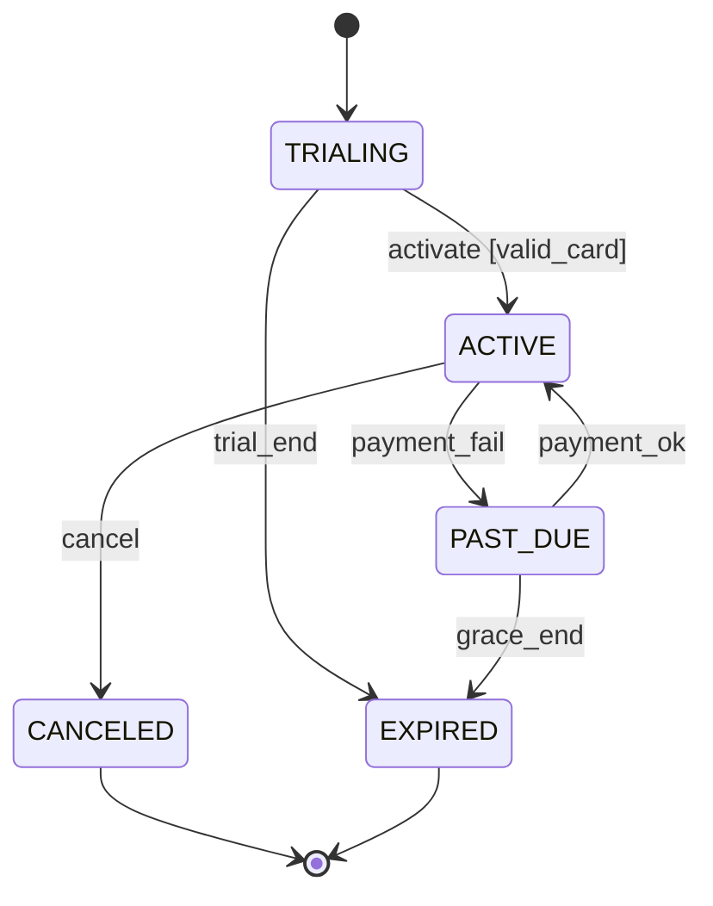

# Black-Box Testing Techniques (First-Principles Mastery)

> **Contents**: [1. Decision Framework](#1-decision-framework) | [2. Step-by-Step Workflow](#2-step-by-step-workflow-all-8-black-box-techniques) | [3. Reusable Artifact & Template](#3-reusable-artifact--template) | [4. Verification Checklist](#4-verification-checklist) | [5. Hard Quality Gate](#5-hard-quality-gate) | [6. Anti-Patterns](#6-anti-patterns)

Black-box testing treats the SUT as $f: X \to Y$ verified strictly against external specs (PRDs, OpenAPI, state machines, UI contracts, RFC error formats) without reading internal branches. This module covers all **8 canonical black-box techniques** with mathematical proofs, worked examples, and browser/API rules.

---

## 1. Decision Framework

### 1.1 Technique Selection & Coverage Criterion Matrix

| Specification / Behavior Shape | Primary Technique(s) | Quantitative Coverage Criterion | Target Layer |
|---|---|---|---|
| **Scalar ranges, enums, strings, dates, pagination** | **1. Equivalence Partitioning (EP)** + **2. Boundary Value Analysis (BVA)** | `100%` valid/invalid partitions (1-invalid-per-case); `3-value BVA` (`7` pts) on critical bounds, `2-value` (`4` pts) low-risk UI | API / Domain (`< 50 ms`) |
| **Stateful workflows, subscriptions, orders, auth** | **3. State Transition Testing** | `100%` valid `0-switch` + critical `1-switch` pairs + `100%` invalid **Sneak Paths** (`409` / unchanged state) | Integration / API FSM |
| **Coupled multi-condition rules, pricing, RBAC** | **4. Decision Table Testing** | `100%` collapsed rule coverage with proof $\sum 2^{d_r} + |\text{Impossible}| = 2^n$ | Pure domain / API |
| **Multi-parameter configs, filters, locales (`>= 3` factors)** | **5. Pairwise / Combinatorial Testing** | `100%` valid `2-wise` tuples via IPOG (`3-wise` only on high-risk billing/safety pairs) | Parameterized API / matrix |
| **Novel flows, race intuition, ambiguous specs** | **6. Exploratory Testing Charters (SBTM)** | `45–90 min` timeboxed (`>= 70%` execution) using `SFDPOT` + `FEW HICCUPPS`; `>= 2` off-happy-path probes | Live UI + DevTools |
| **Critical user journeys, DOM/storage/viewport fit** | **7. E2E / UAT (Playwright & `playwright-interactive`)** | `<= 10–15` critical flows; `getByRole`/`getByLabel`; `getBoundingClientRect()` fit at `390x844` & `1600x900` | Real browser |
| **HTTP/JSON/Webhook boundaries, auth, concurrency** | **8. API Contract & Negative Black-Box** | `100%` OpenAPI endpoints fuzzed; `N=10` idempotency race; RFC 9457 parity; cross-tenant BOLA probe | HTTP client vs live app |

### 1.2 Simplest High-Craft Black-Box Strategy & Anti-Overengineering

Apply two filters before generating huge matrices or browser suites (**Simplest High-Craft Option**):
1. **Push Computation Down**: If an EP, BVA, Decision Table, or API negative rule can run in `< 50 ms` via HTTP or domain call, **never** test it in Playwright; reserve Playwright for browser state, ergonomics, and viewport geometry.
2. **Sparsity-of-Effects Cap (`2-wise` Default)**: Full Cartesian testing of `4` factors (`3` values each) needs $3^4 = 81$ runs ($4^6 = 4,096$ for 6x4). `2-wise` combinatorial arrays capture `~70–90%` of interaction defects in $O(v^2 \log k)$ runs (`~9–16`); escalate to `3-wise` ONLY for proven high-severity interactions.

---

## 2. Step-by-Step Workflow (All 8 Black-Box Techniques)

### 1. Technique 1 — Equivalence Partitioning (EP)

**Workflow**: **Inputs**: Field specs, enums, regex/length caps, HTTP error schemas | **Owner**: QA / API Engineer | **Tool**: `pytest.mark.parametrize` / `vitest` `it.each` | **Output**: Disjoint partition table + minimal vectors.

Partition domain $D$ into mutually exclusive, collectively exhaustive classes $P_1 \dots P_m$ ($\bigcup P_i = D, P_i \cap P_j = \emptyset$), separating **Valid ($V_i$)** from **Invalid ($I_j$)**.

**Invalid Input Isolation Rule (Critical)**: Combine valid partitions freely in positive cases, but **isolate each invalid partition in its own case** with all other fields valid. Bundling two invalid inputs (`seats=0` + `coupon="EXPIRED"`) causes **fault masking**: the first validator hides bugs in the second.

**Worked Example — SaaS Seat-Upgrade (`seats: int [1..500]` tiers `[1..10]`, `[11..50]`, `[51..500]`; `coupon: ^[A-Z0-9]{6,12}$ | ""`)**:
- Valid: $V_1=[1,10]$, $V_2=[11,50]$ (10% off), $V_3=[51,500]$ (20% off); $V_4=\text{""}$, $V_5=\text{"SAVE20NOW"}$.
- Invalid: $I_1=(-\infty,0]$, $I_2=[501,+\infty)$, $I_3=\{\text{5.5, "five", null}\}$; $I_4=\text{"OLD2020"}$ (expired), $I_5=\text{"ab!"}$ (malformed), $I_6=\text{"USEDONCE"}$.

| Case ID | Class Coverage | `seats` | `tier` | `coupon` | Expected Outcome (Oracle) |
|---|---|---|---|---|---|
| `EP-V1` | $V_1 \times \text{pro} \times V_4$ | `5` | `"pro"` | `""` | `200 OK`, base unit price, `$0` coupon |
| `EP-V2` | $V_2 \times \text{pro} \times V_5$ | `25` | `"pro"` | `"SAVE20NOW"` | `200 OK`, 10% tier + active coupon |
| `EP-V3` | $V_3 \times \text{enterprise} \times V_4$ | `120` | `"enterprise"` | `""` | `200 OK`, 20% volume discount |
| `EP-I1` | $I_1$ (isolated) | `-3` | `"pro"` | `""` | `422 Unprocessable`, pointer `/seats` |
| `EP-I2` | $I_2$ (isolated) | `750` | `"pro"` | `""` | `422 Unprocessable`, pointer `/seats` |
| `EP-I3` | $I_3$ (isolated) | `"five"` | `"pro"` | `""` | `400/422`, type error on `/seats` |
| `EP-I4` | $I_4$ (isolated) | `5` | `"pro"` | `"OLD2020"` | `422 Unprocessable`, `coupon_expired` |

---

### 2. Technique 2 — Boundary Value Analysis (BVA)

**Workflow**: **Inputs**: Inclusive/exclusive bounds, byte/grapheme caps, page sizes, TTLs, currency | **Owner**: QA / Backend | **Tool**: Parameterized suite + frozen clock (`freezegun` / `vi.useFakeTimers`) | **Output**: 2- or 3-value BVA matrix.

- **2-Value BVA**: `{min-1, min, max, max+1}` (`4` pts) for low-risk UI fields.
- **3-Value BVA**: `{min-1, min, min+1, nom, max-1, max, max+1}` (`7` pts) — **mandatory** for billing, rate limits, pagination, lockouts, and quotas to distinguish `<` from `<=` and catch boundary rounding bugs.

**Six High-Frequency Domain Boundary Traps**:
1. **Strings & Unicode**: `""`, `"   "`, `max` vs `max+1` across **UTF-8 bytes vs UTF-16 code units vs grapheme clusters** (`"👩🏽‍💻"` = `1` grapheme, `7` UTF-16 units, `15` UTF-8 bytes; `"Đặng Thị Ngọc Hân"` tests NFC/NFD normalization).
2. **Dates, Leap Years & DST**: `2024-02-29` (valid) vs `2025-02-29` (invalid), `23:59:59.999Z -> 00:00:00.000Z`, DST nonexistent (`02:30` `America/New_York`) and ambiguous fall-back hour, `2025-12-31T23:30:00-08:00` UTC year rollover, epoch `1970-01-01T00:00:00Z`.
3. **Pagination (`pageSize=25`)**: `total=0`, `1`, `24`, `25` (`totalPages=1`, NO empty page 2), `26`, `page=0`, `-1`, `> totalPages`.
4. **Currency & Floats**: `$0.00`, `$0.01`, `-$0.01`, `0.1+0.2` IEEE-754 trap (assert integer cents), `$10.005` half-up vs banker's rounding, `BIGINT`/`DECIMAL` ceiling.
5. **TTL & Rate Limits (`5 req/min`, `ttl=900s`)**: Req `#5` (`200`), Req `#6` (`429` + `Retry-After`); token at `expiry-1ms` (valid), `expiry` (verify inclusive spec), `expiry+1ms` (`401`).
6. **Uploads & Payloads**: `0`-byte file (`422`), `max_bytes-1`, `max_bytes` (pass), `max_bytes+1` (`413`), mismatched MIME vs magic bytes.

**Worked 3-Value BVA — `transferAmountCents` (`[100, 1_000_000]`, `$1.00..$10,000.00`)**:

| BVA Point | `transferAmountCents` | Class | Expected HTTP & Ledger Outcome |
|---|---|---|---|
| `min - 1` | `99` | Invalid | `422 Unprocessable` (`below_minimum`) |
| `min` | `100` | Valid (lower bound) | `201 Created`, debit `100` cents |
| `min + 1` | `101` | Valid (near min) | `201 Created`, debit `101` cents |
| `nom` | `500000` | Valid (nominal) | `201 Created`, debit `500000` cents |
| `max - 1` | `999999` | Valid (near max) | `201 Created`, debit `999999` cents |
| `max` | `1000000` | Valid (upper bound) | `201 Created`, debit `1000000` cents |
| `max + 1` | `1000001` | Invalid | `422 Unprocessable` (`exceeds_limit`) |

---

### 3. Technique 3 — State Transition Testing

**Workflow**: **Inputs**: Lifecycle specs (order, subscription, KYC, session/MFA, outbox) | **Owner**: QA / Backend | **Tool**: Mermaid `stateDiagram-v2` + `State x Event` table + API integration suite | **Output**: `0-switch`, `1-switch`, and Sneak Path cases.

- **0-Switch**: Every valid single transition `(S_i --e--> S_j)` runs `>= 1x`.
- **1-Switch (Pairs)**: Every valid 2-step path `(S_i --e1--> S_j --e2--> S_k)` runs `>= 1x` (catches dirty flags/counters left by `e1`).
- **N-Switch**: Critical loops (`TRIALING -> ACTIVE -> PAST_DUE -> ACTIVE -> CANCELED`).
- **Sneak Paths**: Every disallowed `(State, Event)` cell MUST return `409 Conflict` / unchanged state / zero side effects.

**Worked Example — Subscription Billing FSM**:



| State \ Event | `activate` | `payment_fail` | `payment_ok` | `cancel` | `grace_end` |
|---|---|---|---|---|---|
| `TRIALING` | **-> `ACTIVE`** (`[valid_card]`) | **Sneak (`409`)** | **Sneak (`409`)** | **-> `CANCELED`** | **-> `EXPIRED`** (`[trial_end]`) |
| `ACTIVE` | **Idempotent (`200`)** | **-> `PAST_DUE`** (grace timer) | **Idempotent (`200`)** | **-> `CANCELED`** | **Sneak (`409`)** |
| `PAST_DUE` | **Sneak (`409`)** | **Idempotent (`200`)** (retry++) | **-> `ACTIVE`** (clear grace) | **-> `CANCELED`** (void) | **-> `EXPIRED`** (suspend) |
| `CANCELED` | **Sneak (`409`)** | **Sneak (`409`)** | **Sneak (`409`)** | **Idempotent (`200`)** | **Sneak (`409`)** |
| `EXPIRED` | **Sneak (`409`)** | **Sneak (`409`)** | **Sneak (`409`)** | **Sneak (`409`)** | **Sneak (`409`)** |

**Critical 1-Switch Sequences**: (1) `TRIALING --activate--> ACTIVE --payment_fail--> PAST_DUE`; (2) `ACTIVE --payment_fail--> PAST_DUE --payment_ok--> ACTIVE` (verifies grace timer reset); (3) `PAST_DUE --payment_ok--> ACTIVE --cancel--> CANCELED`.

---

### 4. Technique 4 — Decision Table Testing

**Workflow**: **Inputs**: Coupled boolean/multi-valued rules (pricing, tax, RBAC, fraud) | **Owner**: QA / Domain | **Tool**: Collapsed rule table + parameterized tests | **Output**: Minimal complete rule set + completeness proof.

1. Enumerate $n$ conditions ($2^n$ raw binary states) and actions; prune **Impossible** combinations with entry guards.
2. Merge pairs with identical actions differing in exact 1 condition using Don't-Care `-`.
3. **Completeness Proof**: Sum $2^{d_r}$ ($d_r$ = count of `-` in rule $r$) and verify $\sum 2^{d_r} + |\text{Impossible}| = 2^n$ with zero rule overlaps.

**Worked Example — Checkout Engine ($n = 4 \implies 2^4 = 16$, $|\text{Impossible}| = 0$)**:
Conditions: `C1: ProMember`, `C2: CartTotal >= $100`, `C3: ValidPromo`, `C4: HazmatItem`.
Rules: `C4=T` gives `FreeShip=No`, `HazmatFee=$15`, `10%` if `C1=T` else `0%` (ignores `C2, C3`). For `C4=F`: `C1=T` gets `15%` + `FreeShip=Yes` (`C2` ignored); `C1=F & C2=T` gets `FreeShip=Yes`; `ValidPromo=T` adds `10%` (capped at `20%`).

| Condition / Action | `R1` | `R2` | `R3` | `R4` | `R5` | `R6` | `R7` | `R8` |
|---|---|---|---|---|---|---|---|---|
| `C1: ProMember` | `T` | `F` | `T` | `T` | `F` | `F` | `F` | `F` |
| `C2: Cart >= $100` | `-` | `-` | `-` | `-` | `T` | `T` | `F` | `F` |
| `C3: ValidPromo` | `-` | `-` | `T` | `F` | `T` | `F` | `T` | `F` |
| `C4: HazmatItem` | `T` | `T` | `F` | `F` | `F` | `F` | `F` | `F` |
| **$d_r$ / Weight ($2^{d_r}$)** | `2 / 4` | `2 / 4` | `1 / 2` | `1 / 2` | `0 / 1` | `0 / 1` | `0 / 1` | `0 / 1` |
| `A1: Discount %` | `10%` | `0%` | `20%` | `15%` | `10%` | `0%` | `10%` | `0%` |
| `A2: Free Shipping` | `No` | `No` | `Yes` | `Yes` | `Yes` | `Yes` | `No` | `No` |
| `A3: Hazmat Fee` | `$15` | `$15` | `$0` | `$0` | `$0` | `$0` | `$0` | `$0` |

*Completeness Proof*: $\sum 2^{d_r} + |\text{Impossible}| = 4+4+2+2+1+1+1+1 + 0 = 16 = 2^4$, `0` overlaps (`R1..R2` partition `C4=T`; `R3..R4` partition `C4=F, C1=T`; `R5..R8` cover all `4` `(C2, C3)` states for `C4=F, C1=F`). `8` cases prove all `16` states.

---

### 5. Technique 5 — Pairwise / Combinatorial Testing

**Workflow**: **Inputs**: `k >= 3` factors, value sets, forbidden tuples | **Owner**: QA | **Tool**: `allpairspy` / `PICT` / IPOG | **Output**: Minimal `t=2` constrained covering array.

**IPOG Steps**: (1) Sort $|D_1| \ge \dots \ge |D_k|$; (2) Seed full Cartesian product of first 2 factors; (3) **Horizontal growth**: for each remaining column $p_m$, pick the value covering the most uncovered valid pairs `(p_i, p_m)` ($i < m$) without violating constraints; (4) **Vertical growth**: add minimal repair rows for any displaced/uncovered valid pairs.

**Worked Example — 4x3 Checkout Matrix ($3^4 = 81$ combos -> `10`-Row Constrained 2-Wise Covering Array `CA(10; 2, 3^4)`)**:
- Factors: `Plan {Free, Pro, Ent}`, `Payment {Card, SEPA, Invoice}`, `Locale {en-US, de-DE, ja-JP}`, `TaxRegion {US, EU, APAC}`.
- Constraint: `NOT (Payment == SEPA AND TaxRegion == US)`.
- Total 2-wise pairs: $\binom{4}{2} \times 3 \times 3 = 54$; forbidden pairs: `1` (`SEPA + US`); valid pairs: **`53`** (`54 - 1 = 53`). Starting from $OA(9, 3^4)$ (`PW-1..PW-9`), row `PW-5` hits `(SEPA, US)`; changing `US -> EU` fixes the constraint and displaces `(Pro, US)` and `(ja-JP, US)`, which `PW-10` restores (9 rows is impossible by Pigeonhole Principle).

| Row | `Plan` | `Payment` | `Locale` | `TaxRegion` | Notes |
|---|---|---|---|---|---|
| `PW-1` | `Free` | `Card` | `en-US` | `US` | Baseline US card |
| `PW-2` | `Free` | `SEPA` | `de-DE` | `APAC` | SEPA + APAC |
| `PW-3` | `Free` | `Invoice` | `ja-JP` | `EU` | Invoice + EU |
| `PW-4` | `Pro` | `Card` | `de-DE` | `EU` | Pro EU card |
| `PW-5` | `Pro` | `SEPA` | `ja-JP` | `EU` | Repaired `US -> EU` (`NOT SEPA+US`) |
| `PW-6` | `Pro` | `Invoice` | `en-US` | `APAC` | Pro invoice APAC |
| `PW-7` | `Ent` | `Card` | `ja-JP` | `APAC` | Enterprise JP card |
| `PW-8` | `Ent` | `SEPA` | `en-US` | `EU` | Enterprise SEPA EU |
| `PW-9` | `Ent` | `Invoice` | `de-DE` | `US` | Enterprise DE invoice US |
| `PW-10` | `Pro` | `Card` | `ja-JP` | `US` | Vertical repair for `(Pro, US)` + `(ja-JP, US)` |

Result: `10` runs replace `81` (`87.7%` reduction) with **`53/53` (`100%`) valid 2-wise pairs** and `0` constraint violations.

---

### 6. Technique 6 — Exploratory Testing Charters (SBTM)

**Workflow**: **Inputs**: Staging/local app, QA inventory, risk register | **Owner**: QA / Product | **Tool**: SBTM sheet + DevTools + `playwright-cli` (`tracing-start`) | **Output**: Timeboxed session log + defect/regression tickets.

- **Timebox**: `45–90 min` uninterrupted; `Test Design & Execution >= 70%` vs Investigation/Setup.
- **SFDPOT Lenses**: **S**tructure, **F**unction, **D**ata (empty/huge/unicode/stale), **P**latform (mobile/offline), **O**perations (double-click/Back/multi-tab), **T**ime (timeouts/DST/races).
- **FEW HICCUPPS Oracles**: Familiar, Explainable, World, History, Image, Comparable, Claims, User, Product, Purpose, Statutes.
- **Worked Charter (`45 min`)**: Target: Collaborative Checkout + Offline Reconnect (`SFDPOT: Operations, Data, Time` / `FEW HICCUPPS: History, Claims`). Probes: (1) Double-click `Submit Order` `< 100 ms` on `Slow 3G`; (2) Edit coupon offline, reconnect, verify outbox order; (3) Hit `Back` after `201 Created`; (4) Delete item in Tab B while paying in Tab A.

---

### 7. Technique 7 — E2E / UAT (Playwright & `playwright-interactive`)

**Workflow**: **Inputs**: `<= 10–15` critical journeys, dev/staging server, viewports (`390x844`, `1600x900`) | **Owner**: Frontend / QA | **Tool**: `@playwright/test` + `playwright-cli` / `playwright-interactive` | **Output**: Deterministic E2E specs + CSS-pixel screenshots + traces.

1. **Locator Hierarchy**: `getByRole()` (`name`) -> `getByLabel()` -> `getByPlaceholder()`/`getByText()` -> `getByTestId()` last resort (**never** `.card > div:nth-child(3)` CSS/XPath).
2. **Auto-Wait & Zero Sleeps**: Use web-first assertions (`toBeEnabled()`, `toHaveText()`, `toHaveURL()`) and `waitForResponse()`. **ZERO `page.waitForTimeout(...)`**.
3. **Fault Injection**: Keep happy paths on real backend/DB; use `page.route('**/api/v1/**', ...)` for `500`, `429`, `504`, and malformed-JSON recovery.
4. **Functional vs Visual (`playwright-interactive`)**: Drive flows via real clicks/keyboard (never `evaluate()` for signoff); test full toggle cycles (`open -> close -> reopen`), densest data, `390x844`, `1600x900`.
5. **Viewport-Fit (`getBoundingClientRect()`)**: Fixed-height shells hide clipping behind `scrollWidth == innerWidth`; assert `rect.right <= window.innerWidth` and `rect.bottom <= window.innerHeight`.
6. **Screenshot & Trace Discipline**: Capture `type: 'jpeg', quality: 85, scale: 'css'` (no 2x bloat); set `trace: 'on-first-retry'`, `screenshot: 'only-on-failure'`, `video: 'retain-on-failure'`.

---

### 8. Technique 8 — API Contract & Negative Black-Box Verification

**Workflow**: **Inputs**: `openapi.yaml` / JSON Schema, auth tokens (`Tenant A`, `Tenant B`, expired, anon) | **Owner**: Backend / QA | **Tool**: `schemathesis` / `httpx` / `pytest` / `supertest` | **Output**: Fuzz, race, RFC 9457, and BOLA results.

1. **Schema Fuzzing**: Missing `required`, wrong types (`string` for `int`, `[]` for `{}`), `null` on non-nullable, extra keys, `> maxLength` / `> 1 MB` (`413`), invalid JSON (`400`), `Content-Type: text/plain` (`415`), `\u0000` null bytes.
2. **`N = 10` Idempotency & Balance Races**: Send `10` parallel identical `POST`s with same `Idempotency-Key` -> exact `1` DB record + cached replay, `409 Conflict` on mismatched body hash; `10` parallel decrements at limit -> zero negative balances.
3. **RFC 9457 Error Parity**: All `4xx`/`5xx` emit `application/problem+json` `{type, title, status, detail, instance}` with **zero** stack traces, SQL syntax, or filesystem paths.
4. **BOLA Isolation**: Replay `Tenant A` `GET`/`PATCH`/`DELETE` IDs with `Tenant B` token, expired JWT, `alg: none`, and anon -> `401` (unauth) and `403`/`404` (cross-tenant).

---

### 9. Complexity Budget & Deletion/Condensation Pass

Audit before committing: delete any Playwright test duplicating an API EP/BVA/Decision Table check; fold duplicate negative assertions into one parameterized OpenAPI table; verify `N > 0` executed cases; re-run the condensed suite cleanly.

---

## 3. Reusable Artifact & Template

Instantiate [Black-Box Test Matrix Template](../templates/black-box-test-matrix.md) for every feature slice in Spiral `3B` and `3C`.

| Section / Field | Required Content | Verification Rule |
|---|---|---|
| `Matrix Metadata` | `Matrix ID`, `Spiral ID`, `Rigor Tier`, `OpenAPI Ref`, `Verdict` | Links to spec/endpoint; `PASS \| FAIL \| NOT ASSESSED` |
| `1. EP & BVA Table` | `Case ID`, `Technique`, `Partition`, `Vector`, `Oracle` | `1` invalid per row; `3-BVA` on money/auth bounds |
| `2. State & Sneak Paths` | Mermaid `stateDiagram-v2` + `State x Event` table | `0-switch`, critical `1-switch`, `100%` Sneak Paths |
| `3. Decision Table` | Collapsed table (`T`/`F`/`-`) + Impossible + proof | Proves $\sum 2^{d_r} + |\text{Impossible}| = 2^n$ |
| `4. Pairwise Array` | Factors, constraints, `t=2` covering rows | `0` violations; `100%` valid `2-wise` pairs |
| `5. SBTM Charters` | `45–90m` box, `SFDPOT`/`FEW HICCUPPS`, split, bugs | Execution `>= 70%`; bugs -> regression tests |
| `6. Playwright E2E` | `getByRole`/`getByLabel`, `390x844`/`1600x900`, `getBoundingClientRect` | Zero `waitForTimeout`; functional/visual split |
| `7. API Negative` | Fuzz, `N=10` race, RFC 9457, BOLA tenant checks | Zero stack traces; `1` write under `N=10` race |
| `8. Summary & Signoff` | Executed count (`N > 0`), open `P0/P1`, verdict | Fails closed on `N == 0` or open `P0/P1` |

---

## 4. Verification Checklist

- [ ] All invalid equivalence partitions isolated individually to prevent validation fault masking.
- [ ] Three-value boundary analysis applied across currency, pagination, TTL, and rate-limit bounds.
- [ ] State transition matrix tests zero-switch paths, one-switch pairs, and disallowed sneak paths.
- [ ] Collapsed decision table includes verified arithmetic completeness proof matching two-to-the-n total.
- [ ] Pairwise array enforces domain constraints during growth and covers all valid pairs.
- [ ] Exploratory testing charters run in timeboxed sessions using SFDPOT and FEW HICCUPPS.
- [ ] Playwright E2E tests use accessible role locators without fixed timeout sleeps.
- [ ] API negative suite verifies schema fuzzing, idempotency races, RFC 9457, and tenant isolation.

---

## 5. Hard Quality Gate

Black-box verification for any feature slice or API endpoint enforces binary exit criteria:

- **PASS**: All applicable techniques populated with `N > 0` executed tests; zero bundled invalid partitions; Decision Table $\sum 2^{d_r} + |\text{Impossible}| = 2^n$ verified; `100%` Sneak Paths return `409`/conflict; `0` `waitForTimeout`; `N=10` race & BOLA probes pass; `0` open `P0/P1` defects.
- **NOT ASSESSED**: `N == 0` executed tests, or applicable surface skipped without signed waiver.
- **FAIL**: Bundled invalid inputs, Decision Table sum mismatch, Sneak Path returns `200`/`500`, `4xx`/`5xx` leaks stack traces, BOLA leaks data, or `waitForTimeout` in `tests/e2e/`.
- **Evidence Guard**: Retain Playwright traces (`trace: 'on-first-retry'`), JUnit XML, and completed `black-box-test-matrix.md`.

```bash
! grep -rn "waitForTimeout(" tests/e2e/
pytest -q --tb=short tests/blackbox/
npx playwright test --trace=on-first-retry --reporter=junit
```

---

## 6. Anti-Patterns

| Pattern | Why It Fails | Detection Signal | Correct Replacement |
|---|---|---|---|
| **Happy-Path-Only Testing** | Leaves invalid inputs, Sneak Paths, and races untested | Matrix has only `200`/`201` rows; zero `4xx`/`409` | Isolate invalid EP, test all Sneak Paths, fuzz OpenAPI |
| **Bundling Invalid Inputs** | First validator masks downstream parser bugs | Case sends `seats=-1` AND `coupon="BAD"` | Isolate `1` invalid field per case |
| **Cartesian Explosion** | `2^10` or `4^6` fixtures waste CI time | `> 100`-row UI filter matrix | Collapse Decision Tables; use `2-wise` IPOG arrays |
| **`waitForTimeout` Sleeps** | Causes CI flakes and wastes fast-run minutes | `page.waitForTimeout(` in E2E specs | Web-first assertions + `waitForResponse()` |
| **Brittle CSS/XPath** | Refactors break working accessible flows | `.wrapper > div:nth-child(3) > button` | `getByRole()` -> `getByLabel()` -> `getByTestId()` |
| **ScrollWidth Blindness** | `100dvh` shells clip panes while `scrollWidth == innerWidth` | Checks only `documentElement.scrollWidth` | Assert `getBoundingClientRect()` within viewport |
| **E2E Rule Duplication** | Runs 30 coupon/BVA cases in slow Chromium | 20+ browser tests varying only numbers | Push EP/BVA/Decision Tables to `< 50 ms` API tests |
