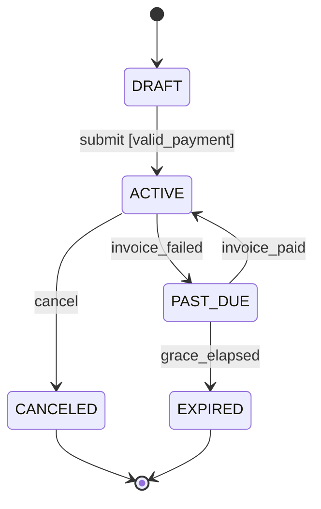

# Black-Box Test Matrix — `<feature-or-endpoint-slug>`

> **Matrix ID**: `<BBM-001>` | **Spiral ID**: `<SP-001>` | **Story / Req IDs**: `<REQ-001..REQ-010>`
> **Rigor Tier**: `<minimal | standard | full>` | **Spec / OpenAPI Ref**: `<openapi.yaml#paths/~1v1~1orders>`
> **Author**: `<author-role>` | **Verdict**: `<PASS | FAIL | NOT ASSESSED>`

---

## 1. Equivalence Partitioning (EP) & Boundary Value Analysis (BVA)

> Enforce the **Invalid Input Isolation Rule**: combine valid partitions together, but isolate **every invalid partition in its own dedicated test case** to prevent validation masking. Apply **3-value BVA** (`{min-1, min, min+1, nom, max-1, max, max+1}`) on billing, auth, pagination, and rate-limit bounds.

| Case ID | Field / Parameter | Technique (`EP | 2-BVA | 3-BVA`) | Partition / Boundary Class (`Valid | Invalid`) | Input Vector | Expected Status & Oracle | Automated Test Ref | Status |
|---|---|---|---|---|---|---|---|
| `<BB-EP-01>` | `<seats>` | `<EP>` | `<Valid V1: [1, 10]>` | `<seats=5, tier="pro", coupon="">` | `<HTTP 200, base rate applied>` | `<tests/bb/seats.test.ts>` | `<PASS>` |
| `<BB-EP-02>` | `<seats>` | `<EP>` | `<Invalid I1: <= 0 (isolated)>` | `<seats=0, tier="pro", coupon="">` | `<HTTP 422, RFC 9457 field=seats>` | `<tests/bb/seats.test.ts>` | `<PASS>` |
| `<BB-BVA-01>` | `<amountCents>` | `<3-BVA>` | `<Boundary min-1 (Invalid)>` | `<amountCents=99>` | `<HTTP 422, minimum_amount>` | `<tests/bb/payment.test.ts>` | `<PASS>` |
| `<BB-BVA-02>` | `<amountCents>` | `<3-BVA>` | `<Boundary min (Valid)>` | `<amountCents=100>` | `<HTTP 201, exact $1.00>` | `<tests/bb/payment.test.ts>` | `<PASS>` |

---

## 2. State Transition & Sneak Path Matrix

| Transition ID | Current State | Event / Trigger | Guard Condition | Next State | Side Effect / Error Code | Coverage Type (`0-Switch | 1-Switch | Sneak Path`) | Status |
|---|---|---|---|---|---|---|---|
| `<ST-01>` | `<DRAFT>` | `<submit>` | `<payment_method != null>` | `<ACTIVE>` | `<Emit sub.activated>` | `<0-Switch>` | `<PASS>` |
| `<ST-02>` | `<ACTIVE -> PAST_DUE -> ACTIVE>` | `<invoice_failed -> invoice_paid>` | `<within grace window>` | `<ACTIVE>` | `<Grace flag cleared, receipt sent>` | `<1-Switch>` | `<PASS>` |
| `<ST-SP-01>` | `<CANCELED>` | `<invoice_paid>` | `<none>` | `<CANCELED (unchanged)>` | `<HTTP 409 state_conflict, 0 ledger writes>` | `<Sneak Path>` | `<PASS>` |

---

## 3. Decision Table (Collapsed) & Completeness Proof

- **Conditions (`n = 3`)**: `C1: <MemberTier == Pro (T/F)>`, `C2: <CartTotal >= $100 (T/F)>`, `C3: <HazmatItem (T/F)>`
- **Impossible / Mutually Exclusive Combinations (`|Impossible| = 0`)**: `<Document excluded combinations and guard checks>`
- **Arithmetic Completeness Proof**: `sum(2^d_r) + |Impossible| = 2^n` -> `<e.g., 2^1 + 2^0 + 2^0 + 2^2 + 0 = 2 + 1 + 1 + 4 + 0 = 8 = 2^3>`

| Condition / Action | `R1` | `R2` | `R3` | `R4` |
|---|---|---|---|---|
| `C1: MemberTier == Pro` | `T` | `F` | `F` | `-` |
| `C2: CartTotal >= $100` | `-` | `T` | `F` | `-` |
| `C3: HazmatItem` | `F` | `F` | `F` | `T` |
| **Don't-Care Count (`d_r`)** | `1` | `0` | `0` | `2` |
| **Weight (`2^d_r`)** | `2` | `1` | `1` | `4` |
| `A1: Discount %` | `15%` | `10%` | `0%` | `0%` |
| `A2: Free Shipping` | `Yes` | `Yes` | `No` | `No (Hazmat fee)` |

---

## 4. Pairwise / Combinatorial Covering Array (`t = 2`)

- **Parameters & Cardinalities**: `<P1: Plan(3), P2: Payment(3), P3: Locale(3), P4: TaxRegion(3)>` (`3^4 = 81` full Cartesian -> `10` constrained pairwise rows covering `53/53` valid pairs)
- **Forbidden Constraints**: `<e.g., NOT (Payment == SEPA AND TaxRegion == US)>`

| Row ID | `<P1>` | `<P2>` | `<P3>` | `<P4>` | Expected Behavior | Automated Test Ref | Status |
|---|---|---|---|---|---|---|---|
| `<PW-01>` | `<Free>` | `<Card>` | `<en-US>` | `<US>` | `<Tax calculated, USD invoice>` | `<tests/bb/pairwise.test.ts>` | `<PASS>` |

---

## 5. Exploratory Testing Charters (SBTM `45–90m`)

| Charter ID | Target Surface | Mission Statement | Timebox (min) | `SFDPOT / FEW HICCUPPS` Focus | Time Split (`Exec / Bug / Setup %`) | Findings & Defect IDs | Debrief Outcome |
|---|---|---|---|---|---|---|---|
| `<EXP-01>` | `<Checkout + Offline Sync>` | `<Probe rapid double-submit, Back navigation, and offline-to-online reconnect>` | `<60>` | `<Data, Operations, Time; History, Claims>` | `<75% / 15% / 10%>` | `<BUG-014 (duplicate toast)>` | `<Regression added>` |

---

## 6. Playwright E2E / UAT & Viewport-Fit Matrix

| Journey ID | User Role | Primary Locators (`getByRole / getByLabel`) | Viewports Tested | `getBoundingClientRect()` Fit? | Functional & Visual Pass? | Trace / Screenshot Artifact |
|---|---|---|---|---|---|---|
| `<E2E-01>` | `<Authenticated Member>` | `<getByRole('button', { name: 'Upgrade' })>` | `<390x844, 1600x900>` | `<Yes (0 overflow)>` | `<Yes (0 console/5xx errors)>` | `<output/playwright/e2e-01-trace.zip>` |

---

## 7. API Contract & Negative Black-Box Matrix

| Probe ID | Endpoint & Method | Mutation Class (`Malformed | Type | Oversize | Race | BOLA | RFC 9457`) | Payload / Header Vector | Expected HTTP & ProblemDetails | Actual Outcome | Status |
|---|---|---|---|---|---|---|
| `<API-01>` | `<POST /v1/orders>` | `<Idempotency Race (N=10)>` | `<10 parallel requests, same Idempotency-Key>` | `<1x 201 Created, 9x cached 201, 1 DB row>` | `<Verified>` | `<PASS>` |
| `<API-02>` | `<GET /v1/orders/{id}>` | `<BOLA / Tenant Isolation>` | `<Tenant B bearer token for Tenant A ID>` | `<HTTP 403/404, zero Tenant A fields>` | `<Verified>` | `<PASS>` |
| `<API-03>` | `<POST /v1/orders>` | `<RFC 9457 Error Parity>` | `<Invalid JSON body / wrong Content-Type>` | `<HTTP 400/415 application/problem+json, 0 stack trace>` | `<Verified>` | `<PASS>` |

---

## 8. Coverage Summary & Sign-Off

- **Total Cases Executed (`N > 0` Guard)**: `<N = integer > 0>`
- **Open `P0 / P1` Defects**: `<0 / 0>`
- **Matrix Verdict**: `<PASS | FAIL | NOT ASSESSED>`
