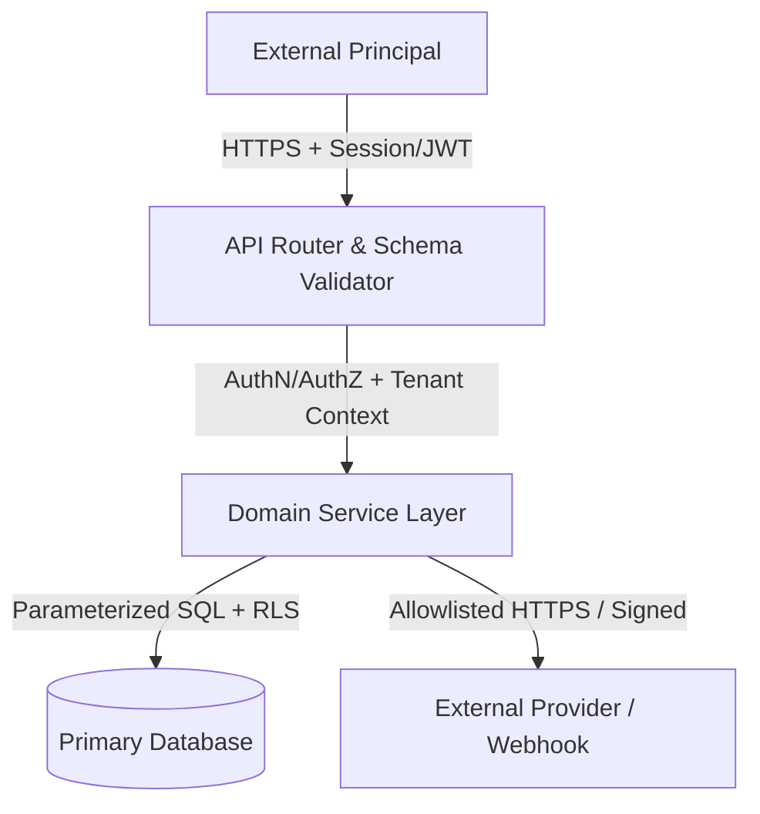

# Threat Model — <component-or-system-name>

- **Model ID**: `TM-<NNN>`
- **Spiral ID**: `SP-<NNN>`
- **Rigor Tier**: `<minimal | standard | full>`
- **Commit / Snapshot**: `<git-sha-or-tag>`
- **Owner**: `<security-or-arch-lead>`
- **Updated (UTC)**: `<YYYY-MM-DDTHH:MM:SSZ>`

---

## 1. Component Overview & Scope (Runtime vs CI/Dev)

- **System Purpose**: <concise 2-3 sentence summary grounded in verified repo entry points and architecture docs>
- **Primary Surfaces**: <web-app | backend-api | mobile-app | dashboard | fullstack>
- **In-Scope Runtime Components**: `<src/api/, src/auth/, db/migrations/, ...>`
- **Separate CI / Build / Dev Tooling**: `<.github/workflows/, scripts/, local dev compose — isolated from runtime trust boundaries>`
- **Explicitly Out of Scope**: `<tests/, fixtures/, docs/, third-party vendor internals>`

---

## 2. Trust Boundaries, Auth & DPIA Assumptions

| Boundary ID | Crossing Path | Protocol / Interface | AuthN & AuthZ Assumption | Encryption & Integrity | Rate Limit / Quota |
|---|---|---|---|---|---|
| `TB-01` | Public Internet -> Edge / API Gateway | `HTTPS / JSON` | Unauthenticated edge; validated at router middleware | TLS 1.3 | `<req/min per IP>` |
| `TB-02` | App Server -> Primary Database / RLS | `TCP / SQL (mTLS)` | Service role scoped + Postgres RLS tenant context | TLS + KMS at rest | Connection pool cap `<N>` |
| `TB-03` | App Server -> External Webhook / LLM / API | `HTTPS` | Signed HMAC / scoped API key; SSRF allowlist | TLS + signature verify | Timeout `<ms>` + circuit breaker |

- **Privacy & DPIA Data-Governance Notes**:
  - **PII / Regulated Classes Processed**: `<email, payment_token_ref, audit_ip, none>`
  - **Retention & Deletion SLA**: `<e.g., 30d soft-delete purge, 90d audit log retention>`
  - **Cross-Tenant / Service-Bypass Risk**: `<where service-role DB client runs and how tenant_id is enforced>`

---

## 3. System Data-Flow Diagram (Mermaid)



---

## 4. Protected Assets & Security Objectives

| Asset ID | Asset Name & Classification | Confidentiality Objective | Integrity Objective | Availability Objective | Primary Storage / Symbol |
|---|---|---|---|---|---|
| `AST-01` | Session / Signing Keys (`Secret`) | Never logged, leaked, or client-exposed | KMS-managed, 90d rotation | Fail-closed if missing in prod | `<env / KMS ref>` |
| `AST-02` | User & Tenant Records (`PII`) | Strictly scoped by owner/tenant RLS | Validated schema + audit trail | Backed up + bounded queries | `<table / schema>` |

---

## 5. Entry Points & Privileged Actions

| Entry ID | Type (HTTP / RPC / Queue / Upload / Action / CLI) | Location (`file:line`) | Untrusted Inputs Accepted | Required Principal & Control |
|---|---|---|---|---|
| `EP-01` | `<HTTP POST /api/v1/...>` | `<path/to/route.ts:line>` | `<JSON body, path param, headers>` | `<Authenticated user + Zod schema + tenant check>` |
| `EP-02` | `<Webhook / Background Job / Upload>` | `<path/to/worker.py:line>` | `<Raw payload / file bytes>` | `<HMAC verify / magic-byte + size cap>` |

---

## 6. STRIDE & Attack Tree Abuse Paths (`TM-001+`)

| Threat ID | STRIDE Category | Abuse Path (`Actor -> Input -> Broken Control -> Impact`) | Likelihood | Impact | Priority | Mitigation / Owner |
|---|---|---|---|---|---|---|
| `TM-001` | Spoofing / EoP | `<e.g., Unauth caller invokes Server Action without session check -> forged tenant mutation>` | `<Low\|Med\|High>` | `<High\|Critical>` | `<Critical\|High\|Med>` | `<Add central auth dependency at route.ts:L42>` |
| `TM-002` | Info Disclosure | `<e.g., Missing tenant filter on batch export endpoint -> cross-tenant PII leak>` | `<Low\|Med\|High>` | `<High\|Critical>` | `<High>` | `<Enforce Postgres RLS + tenant_id WHERE clause>` |

### Attack Tree (Highest-Priority Threat)

```text
Goal: <TM-001 Unauthorized Cross-Tenant State Mutation>
├── [AND] Reachable endpoint accepts client-supplied resource_id
│   ├── [OR] Missing central router auth dependency
│   └── [OR] Service-role DB client bypasses RLS
└── [AND] Missing object-owner predicate before UPDATE/DELETE
```

---

## 7. Security Ownership & Bus-Factor Hotspots

| Sensitive Path / Glob | Primary Owners (`CODEOWNERS`) | Active Contributors (Last 180d) | Bus Factor | Hotspot Status |
|---|---|---|---|---|
| `<src/auth/**>` | `<@team-auth>` | `<N>` | `<1..N>` | `<HEALTHY \| BUS_FACTOR_1 \| ORPHANED>` |
| `<src/crypto/**>` | `<@team-sec>` | `<N>` | `<1..N>` | `<HEALTHY \| BUS_FACTOR_1 \| ORPHANED>` |

---

## 8. Priority Review Focus Paths & Open Questions

- **Focus Paths for Phase 3B / 3C Audit** (`2–30` repo-relative paths):
  1. `<src/auth/session.py>` — session rotation, cookie flags, revocation
  2. `<src/api/routes/export.py>` — tenant isolation, IDOR/BOLA boundary
- **Open Architecture / Infra Questions (`<= 3` targeted questions)**:
  1. `<e.g., Does the upstream reverse proxy strip client-supplied X-Forwarded-For and X-Real-IP headers?>`
  2. `<e.g., Is the database connection pooler running in transaction mode with per-request RLS session variables?>`
